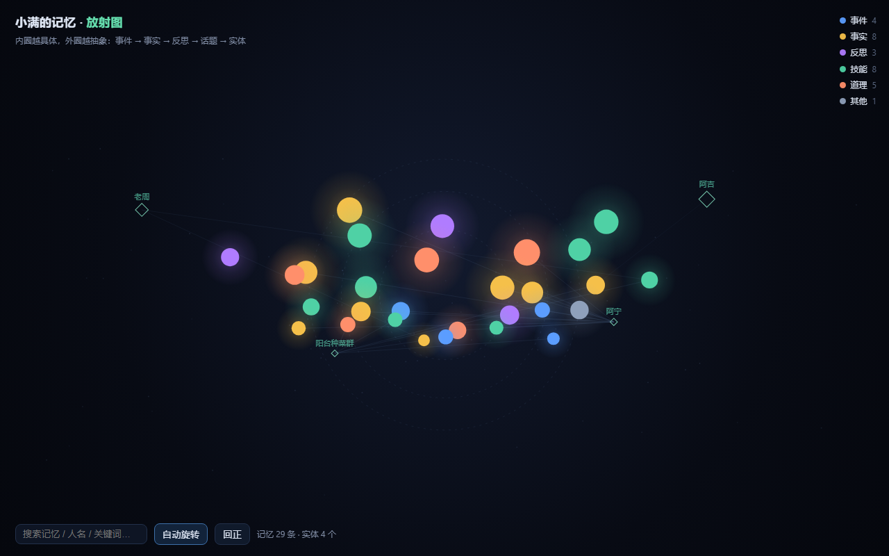

# membrain-lite

给聊天机器人用的**最小记忆内核**：会记、会想、会忘。

不是向量数据库的封装，也不是 RAG 模板。它解决的问题是：

> 一个天天陪你聊天的机器人，三个月后还记不记得你讨厌什么。

核心只有三件事：

1. **写入有取舍** —— 只存「以后用得上」的，一句话能说完就不写一段。
2. **召回有分层** —— 关键词、语义、重要性、新鲜度、图谱五路加权。
3. **遗忘有曲线** —— 不是删掉，是越来越难想起来（三层：习惯 / 可逐渐遗忘 / 边缘）。

零依赖可跑（纯标准库 + SQLite），2 分钟能看到效果。

---

## 快速开始

```bash
git clone <仓库地址>
# 或直接下载 zip 解压
cd membrain-lite

python -m membrain init          # 建库
python -m membrain demo          # 写入 8 条示例记忆
python -m membrain recall "阿宁讨厌什么" --explain
python -m membrain eval          # 跑评估集
```

`recall` 的输出长这样：

```
[0.678] (fact) 阿宁讨厌被叫笨蛋，也讨厌被说「你这样不行」
        why: {"semantic": 0.424, "keyword": 0.6, "importance": 0.92,
              "recency": 1.0, "graph": 0.333, "neighbor": false}
```

`--explain` 会把每一路的分都摊开，调参时看它，排查「她为什么想起这个」也看它。

---

## 它是怎么打分的

```
score = 语义 * 0.18
      + 关键词 * 0.46
      + 重要度 * 0.14
      + 新鲜度 * 0.11
      + 图谱   * 0.11
```

几个刻意的选择：

- **关键词权重最高（0.46）**。中文场景里，用户问「阿宁讨厌什么」，
  真正命中的是「讨厌」两个字，语义向量经常被高频词带偏。
- **语义只用哈希向量兜底**。缺省不下载模型，`Embedder(model="bge-m3")`
  可以换成真的 embedding（需要 `sentence-transformers`）。
- **新鲜度是指数衰减**，不是线性：`s = 0.5 ** (age_days / 半衰期)`。
- **图谱分** = 与种子记忆共享的实体数 / 3，加上邻居记忆的兜底分。

权重、半衰期、去重阈值全在 `config.py` 的 `Weights` / `Decay`，
改完跑一遍 `python -m membrain eval` 就知道有没有变差。

---

## 遗忘：三层与半衰期

| kind | 用来记什么 | 半衰期 |
|---|---|---|
| `fact` | 稳定事实（他是谁、讨厌什么） | 365 天 |
| `lesson` | 教训、原则 | 240 天 |
| `skill` | 具体做法 | 180 天 |
| `reflection` | 反思、情绪 | 60 天 |
| `episode` | 一次性事件 | 21 天 |

- 被想起 **5 次以上** 且强度够 → 进 `habit`（习惯层），基本不会掉
- 强度掉到 **0.18** 以下 → 进 `edge`（边缘层），还查得到但排得靠后
- 超过 `archive_after_days`（默认 400 天）→ 归档，不参与召回

`python -m membrain tick` 手动跑一次衰减（生产环境用 cron 每天一次）。

---

## 接进你的机器人

```python
from membrain.config import Config
from membrain.engine import Engine

eng = Engine(Config.load("config.toml"))

eng.remember("阿宁讨厌被叫笨蛋", kind="fact", importance=0.9,
             who="阿宁", topic="边界")
items = eng.recall("阿宁讨厌什么", k=5)      # 召回
brief = eng.brief()                          # 唤醒时注入的那一小段
```

或者直接起 HTTP 服务（标准库，无框架）：

```bash
python -m membrain serve --port 8765
```

```
GET  /health                  → {"ok": true, "counts": {...}}
GET  /brief                   → {"ok": true, "text": "【关于阿宁的几条硬记忆】…"}
POST /recall   {"query": "…", "k": 5, "explain": true}
POST /remember {"text": "…", "kind": "fact", "importance": 0.9}
POST /tick
```

**会话隔离**是硬规矩：每条记忆都带 `scope`（`group:123` / `private:456`），
`recall(scope=...)` 只返回同 scope + `global` 的。群里的记忆不要带去别的群。

---

## 话术模板

`prompts/` 下是配套的基础话术，直接抄进你的 system prompt：

| 文件 | 内容 |
|---|---|
| `01_persona_core.md` | 她是谁（人格，不含规则） |
| `02_wakeup_brief.md` | 唤醒简报怎么用（只用在简报里有的东西） |
| `03_write_rules.md` | 什么该记什么不该记、五类 kind 怎么选 |
| `04_speak_style.md` | 说话长度、语气、具体 > 抽象 |
| `05_when_upset.md` | 被骂时的四步，以及三条「不要做」 |

这几份比代码更值钱。人格和记忆要解耦：**换人格不用动记忆，换记忆不用动人格。**

---

## 文件结构

```
membrain/
  config.py    权重、半衰期、路径（tomllib 读 config.toml）
  store.py     SQLite：memories / vectors / entities / links / meta
  embed.py     向量（默认 char-bigram 哈希，可选 sentence-transformers）
  decay.py     遗忘曲线与层级
  engine.py    remember / recall / tick / brief
  mirror.py    导出成人能读的 markdown（记忆速查、人物、话题、日记）
  api.py       标准库 HTTP 服务
  cli.py       命令行
  evalrun.py   评估（recall@1 / @3）
prompts/       五份话术模板
data/          seed_demo.jsonl 示例数据（29 条）
eval/          cases.jsonl 评估集
tests/         单元测试
examples/radial/  记忆放射图网页（零依赖）
```

---

## 演示：记忆放射图

`examples/radial/` 里有一个零依赖的网页（纯 canvas，没有 CDN、没有构建）：

- 内圈是**被反复想起的**（habit），中圈在慢慢淡（fading），外圈最早被忘掉（edge）；
- 颜色是记忆类型：事件 / 事实 / 反思 / 技能 / 道理；
- 菱形孤岛是**实体**（人、群、话题），连线表示这条记忆提到了它；
- 拖拽旋转、滚轮缩放、悬停看详情、点图例按类型隐藏、搜索框高亮命中。



跑起来（导出当前库再打开页面）：

```bash
python -m membrain demo
python -m membrain export --out examples/radial/memories.jsonl
python -m http.server 8766           # 然后打开 http://127.0.0.1:8766/examples/radial/
```

页面直接 `fetch('memories.jsonl')`；直接双击打开（`file://`）会被浏览器拦，
所以页面里内置了一份示例数据兜底 —— 打开就能看见效果。

---

## 设计取舍（为什么不做成别的样子）

- **为什么不用向量库？** 几万条记忆用 SQLite 足够，numpy 都不需要。
  真正难的是打分和遗忘，不是存储。
- **为什么不默认下载 embedding 模型？** 骨架要能 `pip install` 完就跑。
- **为什么把「忘」做成三层而不是删？** 删了就真的没了；
  分层的意义是「还查得到，但排在后面」——这才像人。
- **为什么话术单独放 md？** 代码里写死人格，改一次要发版。

---

## 路线图

- [x] 核心：写入 / 五路召回 / 衰减 / 镜像 / HTTP / CLI / 评估
- [x] 话术模板五件套
- [ ] 多人格（同一份记忆，多套 prompts）
- [ ] 记忆冲突检测（同一件事两种说法，标出来给人判断）
- [ ] 导出为 JSONL 增量备份
- [ ] 一个最小 Web 演示页（记忆放射图）

---

## 已知局限（说实话）

- **中文两字词靠字面命中**。缺省哈希向量对「熬夜 vs 半夜」这种同义改写几乎无能，
  真正的语义召回要自己接 `sentence-transformers`（`pip install .[embed]`）。
- **评估集只有 8 条**，100% 只是「没写崩」，不代表好用。
  真想调准，扩到 40 条以上，覆盖「该想起却想不起」的反例。
- **没做冲突检测**。同一件事两种说法会并存，谁排前面看分数。
- **抽取靠调用方**。`remember()` 只负责「存好」，把一段对话切成几条是上层的事。

---

## 隐私

仓库里的示例数据**全是编的**（小满 / 阿宁 / 阿吉 / 老周 / 阳台种菜群），
没有真实 QQ 号、真实群名或真实聊天记录，详见 [docs/PRIVACY.md](docs/PRIVACY.md)。

自己往里加数据以后，提交前跑一下：

```bash
python scripts/check_privacy.py
```

它会扫私人称呼、凭据形态、手机号/QQ 号，命中就返回非零。

## 许可

MIT。拿去用，改，卖都行，别来找我。

如果它对你有用，告诉我一声你拿它做了什么 —— 比 star 有意思。
